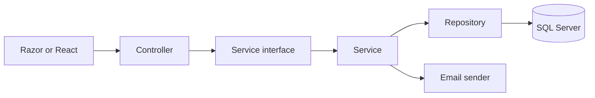

# Code structure

The app has one MVC project and a separate test project. Each folder has one clear job.

```text
SchoolManagement/
  Controllers/      Requests, form validation, redirects and responses
  Models/           User/role/designation models, view models, DTOs and settings
  Interfaces/       Service and repository contracts, one interface per file
  Services/         Login, user registration, email and business rules
  Repositories/     Database reads and writes
  Data/             SQL connection factory, shared transactions and SQL schema setup
  Configuration/    Dependency injection, cookies and security options
  Views/            Razor pages
  ClientApp/        React components and Tailwind source
  wwwroot/          Bootstrap and built frontend assets
  Database/         SQL setup and upgrade scripts
  tests/            Integration tests
```

## How a request flows



Controllers handle HTTP. Services decide what to do. Repositories read/write data.
Dependency injection connects each interface to its implementation in
`Configuration/ServiceRegistration.cs`. Controllers have no SQL or SMTP calls.

### Controller style

- Use a normal constructor with a clearly named service field.
- Each action follows **validate model → call service → return view/redirect**.
- Use explicit `if` blocks for success/failure instead of nested ternary expressions.
- `BaseController` handles current user ID, validation errors and result messages.
- Form models validate reset-link fields and account-status inputs; controllers do not parse Base64.
- User and catalog queries go through service interfaces, keeping repository calls out of controllers.

## Where to make a change

| Change | File |
| --- | --- |
| Login, first password change, forgot/reset password | Services/AccountService.cs |
| User registration and resend login email | Services/UserService.cs |
| Role/designation validation | Services/CatalogService.cs |
| User queries, invitations, activation, last-login and Identity persistence | Repositories/UserRepository.cs |
| Role/designation lists and designation validation | Repositories/SchoolRepository.cs |
| Role creation and first-administrator setup | Repositories/AccountRepository.cs |
| Email delivery handling | Services/NotificationService.cs |
| Email templates and SMTP transport | Services/SmtpEmailSender.cs |
| Password reset links | Services/PasswordLinkService.cs |
| User model and first-login flags | Models/ApplicationUser.cs |
| Database table/column definitions and Identity procedures | Database/SchoolManagement.sql, Database/20261103_DapperIdentity.sql |
| Users table/search UI | ClientApp/src/main.jsx |

`AccountService` contains the authentication flow directly. There is no additional gateway forwarding
the same calls to another service. Each interface and implementing class has its own file:

| Interface | Implementation |
| --- | --- |
| IAccountService | AccountService |
| IUserService | UserService |
| IUserRepository | UserRepository |
| ICatalogService | CatalogService |
| ISchoolRepository | SchoolRepository |
| IAccountRepository | AccountRepository |
| IEmailSender | SmtpEmailSender |
| INotificationService | NotificationService |
| ITemporaryPasswordGenerator | TemporaryPasswordGenerator |

## Database and frontend

`SqlConnectionFactory` creates SQL connections directly from `ConnectionStrings:SchoolManagement`.
`SchoolRepository` and `LoginHistoryRepository` call SQL Server stored procedures through Dapper without a DbContext.
Account last-login updates, designation validation and administrator setup queries also use Dapper procedure calls.
Services have no direct Entity Framework queries.

`UserService` owns user registration and temporary-password business rules. `UserRepository`
uses the scoped `SqlSession` for Dapper calls. `DapperUserStore` adapts ASP.NET Identity to that
repository, while `DapperRoleStore` persists roles and role claims through the same session.
The SQL session owns the connection and active transaction. The school repository supplies
the user form's designation choices and validation.

All 20 application procedures are defined in `Database/20261103_StoredProcedures.sql` with `CREATE OR ALTER`.
Deploy that script manually before running this version. Repositories pass `CommandType.StoredProcedure`
and named parameters. Procedures do not commit the caller's transaction. Updates needing a row count
return it explicitly, because procedures use `SET NOCOUNT ON`.

Entity Framework and ApplicationDbContext have been removed. The 25 Identity procedures are in
`Database/20261103_DapperIdentity.sql`; install that script manually before running this version.
Identity still handles password hashing, validation, normalization, lockout, security stamps and
reset tokens. `UserService` and `AccountRepository` share SQL transactions with the Identity stores,
so failed role assignment or password validation rolls back the entire operation. Identity updates
check concurrency stamps and user rowversion before saving queued membership/claim/token changes.
`DatabaseSetup` reads the SQL schema for the CLI setup commands and initializes only empty databases.

Razor owns routing, forms, validation and antiforgery. React enhances the Users page and reads the
admin-only `/api/users` endpoint. Bootstrap styles forms and navigation; Tailwind utilities use the
`tw:` prefix and omit Preflight. Mutations submit standard Razor POST forms with antiforgery tokens.

## Temporary password flow

1. An administrator registers a user. A strong random password is hashed and stored with a 24-hour expiry.
2. The email contains the login URL, email and temporary password. Plaintext credentials are not saved or logged.
3. First login issues a separate 10-minute password-setup cookie. It cannot access the application's normal pages or APIs.
4. The user chooses a different private password. Identity validates it, rotates the security stamp,
   clears the temporary flags and creates the normal session.
5. Resend generates fresh temporary credentials and invalidates the old password/setup session.
   Email failures retain the account and show a retry message.

Recovery links expire after one hour and are single-use. Inactive users/designations cannot sign in.
Existing accounts retain their current credentials. Cookie keys, connection secrets, and table names
remain configured through the same application settings.

## Login history

LoginHistoryService and LoginHistoryRepository maintain tblUserLoginHistory.
AccountService creates the session marker after a completed login and closes the current session on logout.
Cookie validation preserves that marker across Identity principal refreshes and updates activity/expiry.
Password resets and account deactivation close affected sessions. LoginHistoryCleanupService expires idle
sessions every minute. LoginHistoryController exposes the read-only administrator history page.
See Database/LoginHistory.md for the schema and event meanings.

